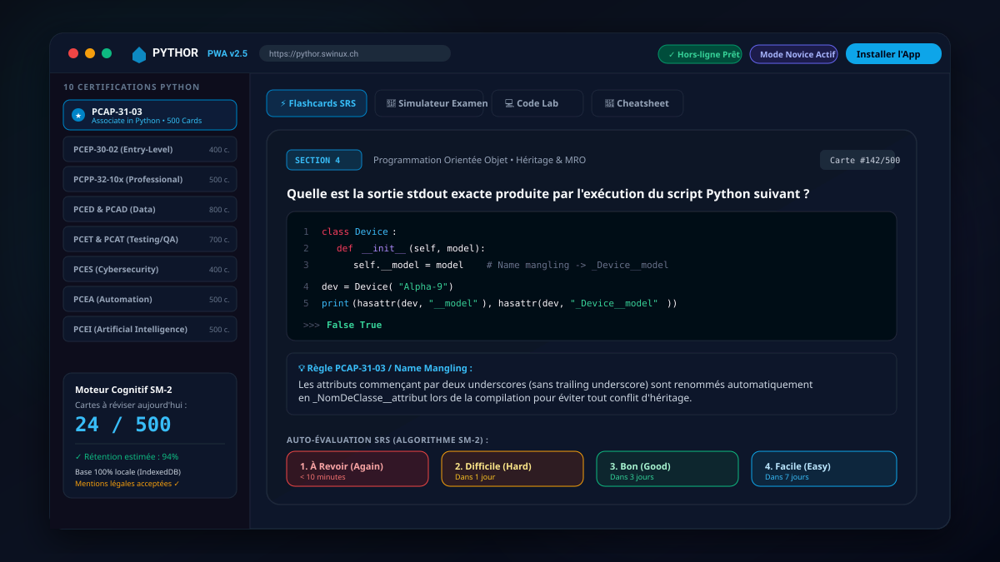

# <p align="center"><br>⚡ PYTHOR</p>

<p align="center">
  <strong>Plateforme PWA d'Entraînement Intensif aux Certifications Officielles Python</strong><br>
  <em>Spaced Repetition System (SM-2) • Simulateur d'Examen Réaliste • Laboratoire de Code • 100% Hors-Ligne & Local-First</em>
</p>

<p align="center">
  <a href="https://pythor.swinux.ch/"></a>
  
  
  
  
  
</p>

---

## 📸 Aperçu de l'Interface

<p align="center">
  
</p>

---

## 🎯 À Propos de Pythor

**Pythor** est une Progressive Web App (PWA) conçue pour accompagner les étudiants, développeurs et professionnels dans la préparation et la réussite des examens officiels du **Python Institute** et de l'écosystème Python professionnel.

L'application intègre un **moteur de répétition espacée (SRS) fondé sur l'algorithme SuperMemo SM-2**, un **simulateur d'examen chronométré** reproduisant fidèlement les critères officiels de certification, un **laboratoire de code interactif (Code Lab)** pour décortiquer les pièges syntaxiques, ainsi qu'un **guide complet des méthodes magiques (Dunder)**.

L'ensemble de vos révisions, scores et cartes personnalisées est stocké **localement sur votre appareil** (IndexedDB / LocalStorage) pour une confidentialité totale et un fonctionnement instantané, même sans connexion Internet.

---

## ⚖️ Mentions Légales & Avertissement de Non-Responsabilité

> ### ⚠️ AVIS DE NON-RESPONSABILITÉ MAJEUR
> **L'auteur, le créateur et l'éditeur de cette application déclinent formellement toute responsabilité quant à l'exactitude, l'exhaustivité, l'actualité ou la pertinence des données, questions, réponses, fragments de code et explications fournis au sein de l'application.**
>
> 1. **Objet Pédagogique Indépendant :** Pythor est un outil d'entraînement autonome et open-source. Il n'est ni affilié, ni sponsorisé, ni validé officiellement par l'OpenEDG Python Institute. Les marques déposées (PCEP™, PCAP™, PCPP™, PCED™, PCAD™, PCET™, PCAT™, PCES™, PCEA™, PCEI™) appartiennent exclusivement à leurs propriétaires respectifs.
> 2. **Absence de Garantie d'Examen :** L'utilisation de cette application ne garantit en aucun cas la réussite aux examens réels de certification.
> 3. **Vérification Personnelle :** L'utilisateur est invité à confronter systématiquement chaque exemple de code et règle de syntaxe avec la documentation officielle Python (`python.org`) et les blueprints officiels du Python Institute.
> 4. **Acceptation Obligatoire :** Dès la première ouverture de l'application, un écran d'accueil d'onboarding soumet cet avis légal à l'acceptation explicite de l'utilisateur. Vous pouvez consulter ces mentions à tout moment depuis le menu ou le pied de page (« Mentions Légales & Guide »).

---

## 🌟 Fonctionnalités Clés

### 🎓 1. Parcours Complet de 10 Certifications Python
Plus de **4 300 questions et flashcards techniques** structurées en 100 cartes par bloc de compétences :

| Code | Intitulé Officiel | Niveau | Volume |
| :--- | :--- | :--- | :--- |
| **PCEP-30-02** | *Certified Entry-Level Python Programmer* | Débutant | 400 cartes (4 sections) |
| **PCAP-31-03** | *Certified Associate in Python Programming* | Intermédiaire | 500 cartes (5 sections) |
| **PCPP-32-10x** | *Certified Professional in Python Programming* | Avancé | 500 cartes (5 sections) |
| **PCED-30-02** | *Certified Entry-Level Data Analyst with Python* | Données | 400 cartes (4 sections) |
| **PCAD-31-02** | *Certified Associate Data Analyst with Python* | Données Avancé | 400 cartes (4 sections) |
| **PCET-30-01** | *Certified Entry-Level Python Tester* | Test & QA | 300 cartes (3 sections) |
| **PCAT-31-0x** | *Certified Associate in Python Testing* | Test Automatisé | 400 cartes (4 sections) |
| **PCES-30-01** | *Certified Entry-Level Cybersecurity with Python* | Sécurité / SecOps | 400 cartes (4 sections) |
| **PCEA-30-01** | *Certified Entry-Level Automation Specialist* | Automatisation | 500 cartes (5 sections) |
| **PCEI-30-01** | *Certified Entry-Level AI Specialist with Python* | IA & Machine Learning | 500 cartes (5 sections) |

---

### 🧠 2. Moteur de Répétition Espacée (Algorithme SM-2)
- **Calcul scientifique de l'oubli :** Facteur de facilité (*Ease Factor*), intervalle de répétition et compteur de répétitions consécutives.
- **Auto-évaluation en 4 crans :**
  - `1. À Revoir (Again)` : Révision immédiate (< 10 min)
  - `2. Difficile (Hard)` : Révision à court terme (1 jour)
  - `3. Bon (Good)` : Révision consolidée (3 à 6 jours)
  - `4. Facile (Easy)` : Espacement maximal (> 7 jours)
- **Priorisation intelligente :** Les questions non maîtrisées reviennent automatiquement en tête de pile.

---

### 🎯 3. Simulateur d'Examen en Conditions Réelles
- **Chronomètre immersif :** Mesure de la durée moyenne par question.
- **Seuils officiels configurés :** Seuil de réussite à **70%** (PCEP, PCAP, PCPP, PCED, PCAD, PCET, PCAT, PCES) ou **75%** (PCEA, PCEI) conforme aux normes du Python Institute.
- **Rétroaction détaillée :** Revue intégrale des erreurs, sortie attendue versus réponse soumise, et explication conceptuelle.
- **Sauvegarde Cloud optionnelle :** Historique des sessions synchronisé via Firebase Firestore (si connecté).

---

### 💻 4. Laboratoire de Code Interactif (Code Lab)
- Bac à sable syntaxique avec exécution simulée de l'interpréteur CPython.
- Démonstrations pratiques des cas complexes : héritage multiple et linéarisation C3 MRO, décorateurs, générateurs, fixtures pytest, sockets défensifs, et standardisation de données IA.

---

### 📖 5. Compendium & Cheatsheet Dunder
- Table de référence exhaustive des méthodes dunder (`__init__`, `__str__`, `__repr__`, `__getitem__`, etc.).
- Règles de *Name Mangling* (convention `_privé` vs `__mangled`).
- Hiérarchie intégrée des classes d'exceptions Python.

---

## 🧭 Accompagnement Novice & Infobulles Contextuelles

Pythor a été spécialement pensé pour guider les débutants et les utilisateurs novices :

1. **Parcours d'Onboarding Interactif :** Guide d'accueil en 4 étapes dès la première visite pour présenter la philosophie de l'application, l'algorithme SM-2, et recueillir le consentement légal.
2. **Mode Novice Actif par Défaut :** Un badge dédié dans la barre de navigation permet d'activer ou désactiver les bulles d'aide à tout moment.
3. **Infobulles Interactives (`InfoTooltip`) :**
   - Sur chaque bouton d'auto-évaluation SRS (`Again`, `Hard`, `Good`, `Easy`).
   - Sur les filtres de modules et jauges d'examen.
   - Sur les champs du créateur de cartes personnalisées.
   - Sur la console et le bouton d'exécution du Code Lab.
   - Accessibles au survol (desktop) et par tapotement (mobile), avec navigation clavier complète (Accessibilité WCAG 2.1 AA).

---

## 📱 Bouton « Installer l'Application » (Guide PWA)

Pythor est une **Progressive Web App (PWA)** certifiée, installable sur tous vos écrans en un seul clic, sans passer par un magasin d'applications.

Un bouton distinctif **« Installer l'App »** est présent en haut de l'écran ainsi que dans le pied de page. En cliquant dessus, l'application vous propose soit l'installation automatique immédiate, soit un guide visuel adapté à votre système :

### 🤖 Sur Android (Google Chrome / Brave / Edge)
1. Cliquez sur le bouton **« Installer l'App »** dans la barre du haut ou le bandeau.
2. Appuyez sur **« Installer »** lorsque le navigateur vous le propose.
3. *Alternative :* Ouvrez le menu Chrome (`⋮`) puis sélectionnez **« Ajouter à l'écran d'accueil »**.

### 🍏 Sur iPhone & iPad (Safari iOS)
1. Ouvrez [https://pythor.swinux.ch/](https://pythor.swinux.ch/) dans **Safari**.
2. Appuyez sur l'icône de partage **Partager** (le carré avec la flèche vers le haut $\uparrow$ en bas de l'écran).
3. Faites défiler vers le bas et touchez **« Sur l'écran d'accueil »** (+).
4. Confirmez en appuyant sur **« Ajouter »**.

### 💻 Sur Ordinateur (Chrome, Edge, Brave sur Windows / macOS / Linux)
1. Cliquez sur l'icône d'installation dans la barre d'adresse du navigateur ($\oplus$ ou petite icône d'ordinateur).
2. Ou cliquez sur le bouton **« Installer l'App »** dans Pythor, puis confirmez l'invite système.
3. L'application s'ouvre dans sa propre fenêtre indépendante, sans barre de navigation web, avec support hors-ligne intégral.

---

## 🛠️ Stack Technique & Architecture

```
pythor/
├── public/
│   ├── assets/
│   │   └── pythor_preview.svg     # Illustration vectorielle de l'interface
│   ├── logo.svg                   # Logo vectoriel Pythor
│   ├── manifest.json              # Web App Manifest PWA (standalone)
│   └── sw.js                      # Service Worker & stratégies de cache hors-ligne
├── src/
│   ├── components/
│   │   ├── common/
│   │   │   ├── InfoTooltip.tsx       # Infobulles accessibles avec conseils novices
│   │   │   ├── InstallPwaButton.tsx  # Bouton d'installation multi-emplacements
│   │   │   ├── InstallPwaModal.tsx   # Modal explicatif d'installation PWA
│   │   │   └── PythorLogo.tsx        # Composant Logo SVG officiel
│   │   ├── onboarding/
│   │   │   └── OnboardingLegalModal.tsx # Onboarding en 4 étapes & mentions légales
│   │   ├── views/
│   │   │   ├── DashboardView.tsx     # Hub des certifications & cartes personnalisées
│   │   │   ├── FlashcardsSrsView.tsx # Moteur de répétition espacée SM-2
│   │   │   ├── ExamSimulatorView.tsx # Simulateur chronométré 70% / 75%
│   │   │   ├── CodeLabView.tsx       # Sandbox d'exécution Python
│   │   │   ├── CheatsheetView.tsx    # Référence Dunder & hiérarchie exceptions
│   │   │   └── LandingPageView.tsx   # Vitrine produit & accès direct
│   │   ├── Navbar.tsx             # En-tête avec raccourcis, logo, PWA & Mode Novice
│   │   └── HamburgerMenu.tsx      # Menu mobile responsive
│   ├── context/
│   │   ├── NoviceModeContext.tsx  # Gestion de l'aide novice & prompt d'installation
│   │   ├── AuthContext.tsx        # Authentification Google / Firebase optionnelle
│   │   └── I18nContext.tsx        # Bilinguisme Français / Anglais
│   ├── data/
│   │   ├── pcapCards.ts           # 500 questions PCAP-31-03
│   │   ├── pcepCards.ts           # 400 questions PCEP-30-02
│   │   ├── pcppCards.ts           # 500 questions PCPP-32-10x
│   │   ├── pcedCards.ts           # 400 questions PCED-30-02
│   │   ├── pcadCards.ts           # 400 questions PCAD-31-02
│   │   ├── pcetCards.ts           # 300 questions PCET-30-01
│   │   ├── pcatCards.ts           # 400 questions PCAT-31-0x
│   │   ├── pcesCards.ts           # 400 questions PCES-30-01
│   │   ├── pceaCards.ts           # 500 questions PCEA-30-01
│   │   └── pceiCards.ts           # 500 questions PCEI-30-01
│   ├── lib/
│   │   └── firebase.ts            # Client Firebase avec fallback invité robuste
│   └── App.tsx                    # Routeur racine & orchestration des modals
```

---

## 🚀 Installation & Développement Local

### Prérequis
- **Node.js** >= 18.x
- **npm** >= 9.x

### Lancement
```bash
# 1. Cloner le dépôt GitHub
git clone https://github.com/jeanpierrenouhailler-dot/Pythor.git
cd Pythor

# 2. Installer les dépendances
npm install

# 3. Lancer le serveur de développement Vite
npm run dev

# 4. Compiler pour la production (Cloudflare Pages)
npm run build
```

---

## 📄 Licence

Ce projet est sous licence **MIT**. Vous êtes libre de l'utiliser, de le modifier et de l'adapter selon vos besoins. Consultez le fichier `LICENSE` pour plus de détails.
